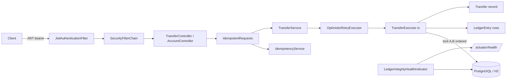

# HarakaPay


**HarakaPay** is a mobile-money style payments backend: customers register, get a KES wallet, simulate
M-Pesa-style deposits, and move money between wallets with P2P transfers — all recorded on a
**double-entry ledger** with **idempotent** request handling, JWT authentication and a reconciliation
health check that proves balances and the ledger never drift apart.

> *Haraka* means *fast* in Swahili. The project models the core of what payment platforms such as
> Cellulant operate: collections, wallets and settlement-grade audit trails.

---

## Why this project

Most portfolio CRUD apps stop at "an entity and a controller". HarakaPay is built around the
problems that actually matter in payments engineering:

| Problem | How HarakaPay handles it |
|---|---|
| "The client retried and we charged twice" | Every money mutation requires an `Idempotency-Key`; retries replay the exact stored response, key reuse with a different payload is a `409` |
| "Two transfers drained one balance" | `SELECT ... FOR UPDATE` in a deterministic (ascending id) lock order, an optimistic `version` column as second line of defence, and bounded retry with backoff |
| "Books don't match balances" | Every balance change is two ledger legs (DEBIT/CREDIT); a health indicator recomputes balances from the ledger and flips `/actuator/health` to DOWN on any mismatch |
| "Rejected payments vanish" | Failed transfers are persisted with a failure reason in an independent transaction, so audit rows survive the rollback |
| "Errors are strings" | All failures are RFC 7807 problem documents with stable machine-readable `code`s |

The full debugging story behind the concurrency fix is written up in
[`docs/CHALLENGE_JOURNAL.md`](docs/CHALLENGE_JOURNAL.md), and the key design choices in
[`docs/DESIGN_DECISIONS.md`](docs/DESIGN_DECISIONS.md).

## Architecture



- **Money** is integer minor units (`KES 1.00 == 100`), never floating point.
- **Ledger** entries are immutable; balances are mutable but always replayable from the ledger.
- **Schema** is owned by Flyway; Hibernate runs with `ddl-auto: none`.
- **Tests** run the real migrations against H2 in PostgreSQL mode — no Docker needed for CI.

## Tech stack

Java 21 · Spring Boot 3.5 (Web, Data JPA, Security, Validation, Actuator) · PostgreSQL · Flyway ·
H2 (tests) · JJWT · springdoc-openapi · Micrometer/Prometheus · JUnit 5, Mockito, AssertJ, MockMvc ·
JaCoCo · Docker · GitHub Actions

## Quick start

```bash
# 1. start PostgreSQL and the app
docker compose up --build

# 2. or run locally against the compose database
docker compose up -d postgres
./mvnw spring-boot:run
```

Then: Swagger UI at <http://localhost:8080/swagger-ui.html>, health at
<http://localhost:8080/actuator/health>, metrics at <http://localhost:8080/actuator/prometheus>.

### Run the tests

```bash
./mvnw verify          # 36 tests: unit + full HTTP integration, JaCoCo report in target/site/jacoco
```

## API tour

| Method | Path | Notes |
|---|---|---|
| POST | `/api/v1/auth/register` | creates user **and** wallet, returns JWT |
| POST | `/api/v1/auth/login` | neutral failure message (no user enumeration) |
| GET | `/api/v1/accounts/me` | balance, status, currency |
| POST | `/api/v1/accounts/me/topups` | simulated M-Pesa deposit, idempotent |
| GET | `/api/v1/accounts/me/statement?page&size` | paged ledger statement, newest first |
| POST | `/api/v1/transfers` | P2P transfer, idempotent |
| GET | `/api/v1/transfers/{id}` | participant-only (404 for strangers) |
| GET | `/api/v1/transfers/{id}/entries` | the DEBIT + CREDIT legs |
| GET | `/actuator/health` | includes `ledgerIntegrity` reconciliation check |

A scripted walkthrough lives in [`docs/API_EXAMPLES.http`](docs/API_EXAMPLES.http).

```bash
TOKEN=$(curl -s -X POST localhost:8080/api/v1/auth/register \
  -H 'Content-Type: application/json' \
  -d '{"email":"frankie@example.com","fullName":"Frankie N","password":"Sup3rSecret!x"}' \
  | sed -E 's/.*"accessToken":"([^"]+)".*/\1/')

curl -s -X POST localhost:8080/api/v1/accounts/me/topups \
  -H "Authorization: Bearer $TOKEN" -H 'Idempotency-Key: deposit-00000001' \
  -H 'Content-Type: application/json' -d '{"amountMinor":500000,"narrative":"salary"}'

curl -s -X POST localhost:8080/api/v1/transfers \
  -H "Authorization: Bearer $TOKEN" -H 'Idempotency-Key: transfer-00000001' \
  -H 'Content-Type: application/json' \
  -d '{"targetAccountNumber":"HAR-000002","amountMinor":200000,"narrative":"lunch"}'
```

## Configuration

| Variable | Default | Purpose |
|---|---|---|
| `SPRING_PROFILES_ACTIVE` | `local` | `local` (PostgreSQL) / `test` (H2) |
| `HARAKA_JWT_SECRET` | dev-only value | **≥ 32 bytes**; the app refuses to boot with a weak secret |
| `HARAKA_PG_HOST/PORT/DB/USER/PASSWORD` | localhost / 5432 / haraka | database connection |
| `HARAKA_JWT_TTL_MINUTES` | 120 | token lifetime |
| `HARAKA_IDEMPOTENCY_RETENTION_DAYS` | 7 | idempotency record retention |

Operational notes (JDBC pool, metrics, cleanup job) are in [`docs/RUNBOOK.md`](docs/RUNBOOK.md).

## Test coverage of the hard parts

- `TransferConcurrencyTest` — 30 opposing concurrent transfers: no lost updates, no deadlocks, money conserved
- `TransferIdempotencyTest` — replay honesty, payload-mismatch rejection, per-endpoint scoping, concurrent duplicate keys
- `TransferFlowTest` — atomic money movement, ledger legs, participant-only visibility, audited failures
- `LedgerIntegrityHealthTest` — corrupting a balance flips the health endpoint to DOWN (503)
- `AuthFlowTest`, `JwtServiceTest`, `MoneyPolicyTest`, `StatementPagingTest`, `IdempotencyHasherTest`

## Author

Built by **Frankie Ngaruiya** ([@Frankie7techy](https://github.com/Frankie7techy)) as a portfolio
demonstration of production-grade backend Java engineering for fintech.

## License

[MIT](LICENSE)
